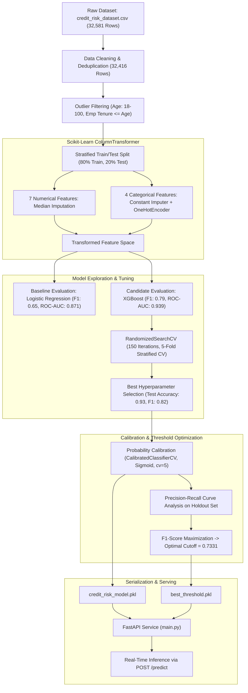
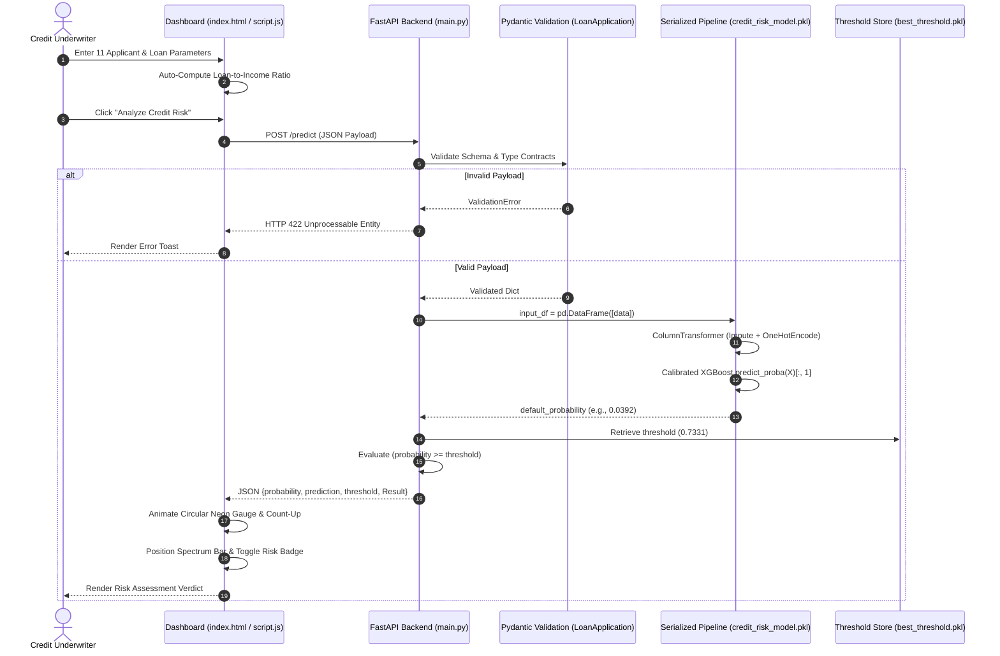

# Credit Ledger — ML-Based Loan Risk Assessment System

> **Intelligent consumer credit risk assessment engine powered by Calibrated XGBoost and served via a high-performance FastAPI backend with a Neo-Fintech dashboard.**

[](https://www.python.org/)
[](https://fastapi.tiangolo.com/)
[](https://scikit-learn.org/)
[](https://xgboost.readthedocs.io/)
[](https://pandas.pydata.org/)
[](LICENSE)

---

**Credit Ledger**: [@LIVE](https://credit-ledger-ml-based-loan-risk.onrender.com)

---

## 1. Overview

**Credit Ledger** is an end-to-end Machine Learning underwriting system designed to estimate the probability that a retail loan applicant will default on credit commitments. 

In traditional consumer lending, rule-based heuristics or uncalibrated credit-scoring models frequently produce either elevated false negatives (approving borrowers who default, resulting in heavy capital loss) or severe false positives (turning away creditworthy applicants, forfeiting interest revenue).

Credit Ledger addresses this challenge through an empirical, machine-learning-driven approach:
- Evaluates **11 multi-dimensional financial, demographic, and credit bureau vectors**.
- Employs an **extreme gradient boosting (XGBoost)** classifier pipeline tuned via randomized search.
- Applies **Platt Scaling (Sigmoid Calibration)** via cross-validation to ensure predicted probability values reflect true empirical default rates.
- Enforces a **loss-matrix-optimized decision threshold ($0.7331$)** derived from Precision-Recall curve F1 maximization rather than relying on a naive $0.50$ cutoff.
- Delivers real-time inference via an asynchronous **FastAPI** service coupled with a **Neo-Fintech single-page dashboard**.

---

## 2. Key Features

- **Applicant Profile Assessment**: Captures applicant age, verified annual gross income, home ownership status, and employment tenure.
- **Loan Exposure & Pricing Sizing**: Ingests requested loan principal, borrowing intent, assigned underwriting grade ($A$–$G$), and annual interest rate.
- **Dynamic Debt-to-Income (DTI) Calculation**: Real-time client-side calculation of the loan-to-income ratio (`loan_amnt / person_income`) with manual override flexibility.
- **Credit Bureau Delinquency History**: Factors in prior historical default records and seasoned credit bureau history length.
- **Calibrated Probability Estimation**: Returns continuous default probabilities ($0.0\%$ to $100.0\%$) calibrated against historical empirical default frequencies.
- **Serialized Decision Threshold**: Decouples the decision boundary from hardcoded source code by dynamically loading `best_threshold.pkl` ($0.7331$) during service startup.
- **Dual Classification Verdicts**: Explicit binary classification (`Low Risk` vs. `High Risk`) paired with tailored underwriting policy recommendations.
- **Production RESTful Backend**: FastAPI application with strict Pydantic schema validation, asynchronous lifespan resource management, and automated OpenAPI documentation.
- **Neo-Fintech Midnight Aurora Interface**: Modern, responsive dashboard engineered with vanilla HTML5, CSS3, and JavaScript, featuring:
  - Ambient particle background canvas.
  - Interactive SVG probability gauge with ease-out count-up animation.
  - 0% to 100% visual decision spectrum comparison bar.
  - 1-click **Prime** and **High Risk** demonstration presets.
  - Live heartbeat connection indicator monitoring backend engine latency.

---

## 3. Application Interface Overview

```text
+---------------------------------------------------------------------------------------------------+
|  [Credit Ledger]  AI Risk Engine v2.4                                       [ Engine Online (18ms) ]|
+---------------------------------------------------------------------------------------------------+
|  Smarter Decisions. Better Risk Intelligence.                                                     |
|  Calibrated machine-learning credit risk intelligence & real-time decision cutoff.                 |
+---------------------------------------------------------------------------------------------------+
|  STEP 01: Applicant Profile       |  STEP 02: Loan Details           |  STEP 03: Credit Bureau    |
|  - Borrower Age: 30 yrs           |  - Purpose: Personal Financing   |  - Prior Default: No (N)   |
|  - Annual Income: INR 600,000     |  - Loan Grade: Grade B           |  - Credit History: 6 yrs   |
|  - Home Ownership: Renting        |  - Loan Amount: INR 100,000      |                            |
|  - Employment: 5.0 yrs            |  - APR: 11.5% | DTI Ratio: 0.17  |                            |
+-----------------------------------+----------------------------------+----------------------------+
|                                      [ ANALYZE CREDIT RISK ]                                      |
+---------------------------------------------------------------------------------------------------+
|                                     RISK ASSESSMENT VERDICT                                       |
|                                                                                                   |
|         (( 3.9% ))                   [ DECISION THRESHOLD BENCHMARK ]                             |
|    DEFAULT PROBABILITY               0% [======*====================|====================] 100%   |
|                                                Borrower: 3.9%        Cutoff: 73.3%                |
|    [ LOW RISK — APPROVED ]                                                                        |
|                                      * Default Probability : 3.9%                                 |
|                                      * Decision Threshold  : 73.3%                                |
|                                      * Model Verdict       : Low Risk                             |
+---------------------------------------------------------------------------------------------------+
```

> *The interface features a responsive two-column grid, interactive SVG probability gauge, animated debt-to-income sizing, and live engine status.*

---

## 4. Technology Stack

| Layer | Technology | Version | Purpose |
| :--- | :--- | :--- | :--- |
| **Backend Framework** | **FastAPI** | `0.115.0` | Asynchronous REST API, lifespan management & static file routing |
| **ASGI Server** | **Uvicorn** | `0.30.6` | High-performance ASGI production server |
| **Data Validation** | **Pydantic** | `2.9.2` | Strict request schema verification and type casting |
| **ML Framework** | **Scikit-learn** | `1.6.1` / `1.7.2` | Data pipelines, imputation, encoders, and probability calibration |
| **Classifier Model** | **XGBoost** | `3.4.1` | Extreme gradient boosted decision tree ensemble |
| **Data Processing** | **Pandas** | `2.2.2` | Tabular data manipulation and DataFrame structuring |
| **Model Persistence** | **Joblib** | `1.4.2` | Binary serialization of trained pipeline and decision threshold |
| **Model Interpretability**| **SHAP** | `0.54.1` | TreeExplainer feature attribution & waterfall diagnostics (notebook) |
| **Frontend UI** | **HTML5 / CSS3 / Vanilla JS** | ES6+ | Modern, responsive dashboard; zero heavy framework dependencies |
| **Typography & Icons** | **Google Fonts & Lucide** | Latest | Plus Jakarta Sans, Inter, JetBrains Mono & Lucide icons |
| **Deployment** | **Render** | Cloud Native | Infrastructure-as-code deployment via `render.yaml` |

---

## 5. Machine Learning Workflow

The end-to-end model training, validation, and serialization workflow implemented in [`Credit_Risk.ipynb`](Credit_Risk.ipynb) proceeds through the following verified pipeline:



### Verified Pipeline Stages:
1. **Data Acquisition**: Ingestion of `credit_risk_dataset.csv` containing 32,581 records across 12 raw columns.
2. **Data Cleaning & Sanitation**:
   - Removal of duplicate records ($32,581 \rightarrow 32,416$ rows).
   - Domain-level outlier filtering: valid borrower age bounded to $18 \le \text{age} \le 100$; employment tenure constrained to $\le \text{age}$ and $\le 60$; positive loan amount.
   - Target variable `loan_status`: 78.18% non-default ($0$), 21.82% default ($1$).
3. **Stratified Split**: Stratified 80/20 train/test partition ($25,932$ training rows, $6,305$ holdout validation rows; `random_state=42`).
4. **Scikit-Learn Preprocessing Pipeline**:
   - Numerical columns ($7$ features): `SimpleImputer(strategy='median')`.
   - Categorical columns ($4$ features): `SimpleImputer(strategy='constant', fill_value='Missing')` followed by `OneHotEncoder(handle_unknown='ignore')`.
5. **Class Imbalance Handling**: Computed negative-to-positive ratio (`scale_pos_weight = neg / pos ≈ 3.58`) to counter default minority under-representation.
6. **Cross-Validation & Model Selection**:
   - Evaluated candidate algorithms across 5-fold stratified cross-validation.
   - **Baseline Logistic Regression**: ROC-AUC: $0.871$, Accuracy: $0.812$, Precision: $0.545$, Recall: $0.778$, F1: $0.641$.
   - **XGBoost Classifier**: ROC-AUC: $0.939$, Accuracy: $0.910$, Precision: $0.798$, Recall: $0.786$, F1: $0.791$.
7. **Hyperparameter Optimization**: Executed `RandomizedSearchCV` across 150 iterations with 5-fold cross-validation optimizing `average_precision`. Optimal parameters:
   - `n_estimators`: 553
   - `max_depth`: 8
   - `learning_rate`: 0.0819
   - `subsample`: 0.9755
   - `colsample_bytree`: 0.6945
   - `min_child_weight`: 8
   - `gamma`: 1.5001
8. **Probability Calibration**: Uncalibrated tree models often produce distorted, pushed-to-the-boundary predicted probabilities. The tuned estimator was wrapped with `CalibratedClassifierCV(method="sigmoid", cv=5)` (Platt Scaling) to generate reliable default probabilities.
9. **Empirical Threshold Selection**: Generated Precision-Recall curves over calibrated test probabilities. Rather than assigning predictions at $0.50$, the optimal decision boundary was calculated by maximizing the F1 score:
   $$\text{Threshold}^* = \operatorname*{arg\,max}_{\tau} \left( \frac{2 \cdot P(\tau) \cdot R(\tau)}{P(\tau) + R(\tau) + 10^{-9}} \right) = 0.7331166...$$
10. **Explainability Analysis (SHAP)**: Examined global feature contributions and individual waterfall explanations using `shap.TreeExplainer` over transformed feature representations in the notebook.

---

## 6. Input Features

The application consumes exactly **11 input features** across three structured domains:

| Category | Field Name | Data Type | Permissible Range / Values | Technical Description |
| :--- | :--- | :--- | :--- | :--- |
| **Applicant** | `person_age` | `Integer` | $18 \le \text{age} \le 100$ | Borrower age in completed years. |
| **Applicant** | `person_income` | `Float` | $> 0$ | Total verified annual gross income (INR). |
| **Applicant** | `person_home_ownership` | `String` | `RENT`, `MORTGAGE`, `OWN`, `OTHER` | Housing tenure arrangement of the applicant. |
| **Applicant** | `person_emp_length` | `Float` | $\ge 0.0$ | Continuous tenure with current employer in years. |
| **Loan** | `loan_intent` | `String` | `PERSONAL`, `EDUCATION`, `MEDICAL`, `VENTURE`, `HOMEIMPROVEMENT`, `DEBTCONSOLIDATION` | Underlying commercial purpose of requested loan. |
| **Loan** | `loan_grade` | `String` | `A`, `B`, `C`, `D`, `E`, `F`, `G` | Risk grading assigned to loan facility tier. |
| **Loan** | `loan_amnt` | `Float` | $> 0$ | Total requested principal credit facility amount. |
| **Loan** | `loan_int_rate` | `Float` | $0.0 < \text{rate} \le 40.0$ | Annual percentage interest rate (APR %). |
| **Loan** | `loan_percent_income` | `Float` | $0.00 \le \text{ratio} \le 1.00$ | Debt sizing ratio calculated as `loan_amnt / person_income`. |
| **Credit Bureau** | `cb_person_default_on_file` | `String` | `N`, `Y` | Flag indicating historical default registered with bureau. |
| **Credit Bureau** | `cb_person_cred_hist_length` | `Integer` | $\ge 0$ | Seasoning duration of borrower's credit bureau file in years. |

---

## 7. Model Prediction & Decision Contract

### Prediction Workflow
1. The client submits a JSON payload containing the 11 feature fields to `POST /predict`.
2. Pydantic validates data types, rejecting malformed requests with `HTTP 422`.
3. The dictionary is packaged into a single-row Pandas DataFrame.
4. `credit_risk_model.pkl` transforms features through its internal `ColumnTransformer` (median numerical imputation, categorical one-hot encoding) and passes them to the calibrated XGBoost ensemble.
5. The model generates $P(\text{default} = 1 \mid \mathbf{x}) = \text{default\_probability}$.
6. The score is evaluated against the calibrated threshold:
   $$\text{default\_prediction} = \begin{cases} 1 & \text{if } P(\text{default}) \ge \text{threshold} \\ 0 & \text{if } P(\text{default}) < \text{threshold} \end{cases}$$
7. The service formats and returns the structured decision payload.

### API Response Contract:
```json
{
  "default_probability": 0.03922985621929133,
  "default_prediction": 0,
  "threshold": 0.733116628245256,
  "Result": "Low Risk"
}
```

- `default_probability` (`float`): Continuous calibrated probability of loan delinquency.
- `default_prediction` (`integer`): Binary decision flag ($0$ = Non-default, $1$ = Default).
- `threshold` (`float`): The active decision boundary cutoff ($0.7331$).
- `Result` (`string`): Executive risk label (`"Low Risk"` or `"High Risk"`).

---

## 8. System Architecture



---

## 9. Installation and Setup

### Prerequisites
- **Python**: Version `3.11.x` (or `3.12+` / `3.13` with matching dependencies)
- **Git** installed on your system
- Modern Web Browser (Chrome, Firefox, Edge, Safari)

### Local Environment Setup (Windows / macOS / Linux)

1. **Clone the Repository**:
   ```bash
   git clone https://github.com/your-username/Credit-Risk-Assesment-using-SHAP.git
   cd Credit-Risk-Assesment-using-SHAP
   ```

2. **Create and Activate a Virtual Environment**:
   - **Windows (PowerShell)**:
     ```powershell
     python -m venv venv
     .\venv\Scripts\Activate.ps1
     ```
   - **macOS / Linux**:
     ```bash
     python3 -m venv venv
     source venv/bin/activate
     ```

3. **Install Project Dependencies**:
   ```bash
   pip install --upgrade pip
   pip install -r requirements.txt
   ```

4. **Launch the FastAPI Server**:
   ```bash
   uvicorn main:app --host 127.0.0.1 --port 8000 --reload
   ```

5. **Access the Application**:
   - **Underwriting Dashboard**: Open [http://127.0.0.1:8000](http://127.0.0.1:8000)
   - **Interactive API Documentation (Swagger)**: [http://127.0.0.1:8000/docs](http://127.0.0.1:8000/docs)
   - **OpenAPI JSON Specification**: [http://127.0.0.1:8000/openapi.json](http://127.0.0.1:8000/openapi.json)

---

## 10. API Documentation

### 1. Risk Assessment Prediction
- **Endpoint**: `/predict`
- **Method**: `POST`
- **Content-Type**: `application/json`

#### Example Request:
```bash
curl -X POST "http://127.0.0.1:8000/predict" \
     -H "Content-Type: application/json" \
     -d '{
       "person_age": 30,
       "person_income": 600000.0,
       "person_home_ownership": "RENT",
       "person_emp_length": 5.0,
       "loan_intent": "PERSONAL",
       "loan_grade": "B",
       "loan_amnt": 100000.0,
       "loan_int_rate": 11.5,
       "loan_percent_income": 0.17,
       "cb_person_default_on_file": "N",
       "cb_person_cred_hist_length": 6
     }'
```

#### Example Response (HTTP 200 OK):
```json
{
  "default_probability": 0.03922985621929133,
  "default_prediction": 0,
  "threshold": 0.733116628245256,
  "Result": "Low Risk"
}
```

---

### 2. Service Health & OpenAPI Schema
- **Endpoint**: `/openapi.json`
- **Method**: `GET`
- **Description**: Returns the comprehensive OpenAPI v3 schema. Polled client-side by the dashboard to verify live engine connectivity.

---

## 11. Project Structure

```
Credit-Risk-Assesment-using-SHAP/
├── .ipynb_checkpoints/          # Jupyter Notebook auto-checkpoints
├── static/                      # Static web assets served by FastAPI
│   ├── index.html               # Single-page Neo-Fintech dashboard markup
│   ├── style.css                # Midnight Aurora CSS design system & animations
│   └── script.js                # Client logic, particle canvas & async API integration
├── best_threshold.pkl           # Serialized optimal cutoff threshold (float: 0.7331)
├── Credit_Risk.ipynb            # Data cleaning, EDA, pipeline tuning, calibration & SHAP
├── credit_risk_dataset.csv      # Raw credit risk historical dataset (32,581 records)
├── credit_risk_model.pkl        # Serialized CalibratedClassifierCV(Pipeline, cv=5)
├── main.py                      # FastAPI application, lifespan loader & prediction routes
├── render.yaml                  # Render Infrastructure-as-Code deployment manifest
├── requirements.txt             # Verified pinned Python dependencies
├── runtime.txt                  # Deployment Python runtime specification (python-3.11.9)
└── README.md                    # Project documentation
```

---

## 12. Deployment Guide

The repository includes native deployment configuration for [Render](https://render.com/) via [`render.yaml`](render.yaml):

```yaml
services:
  - type: web
    name: credit-ledger
    runtime: python
    plan: free
    buildCommand: pip install -r requirements.txt
    startCommand: uvicorn main:app --host 0.0.0.0 --port $PORT
    autoDeploy: true
```

### Steps to Deploy on Render:
1. Push your repository to **GitHub**.
2. Log in to the **Render Dashboard** and select **New > Blueprint**.
3. Connect your repository. Render will automatically detect `render.yaml` and `runtime.txt` (`python-3.11.9`).
4. Click **Apply**. Render will execute `pip install -r requirements.txt` and launch the web service via Uvicorn.

---

## 13. Future Roadmap

- [ ] **Live SHAP API Integration**: Expose an endpoint (`POST /explain`) delivering real-time feature attribution values to render live waterfall charts directly in the UI.
- [ ] **Persistent Audit History**: Implement a SQLite / PostgreSQL persistence layer to log all submitted assessments with timestamped audit trails.
- [ ] **Role-Based Access Control (RBAC)**: Secure underwriting routes with JWT-based authentication for loan officers vs. risk administrators.
- [ ] **Model Drift & Monitoring**: Track feature drift (e.g. population shift in interest rates or income) using Evidently AI or automated Kolmogorov-Smirnov statistical tests.
- [ ] **Batch Portfolio Scoring**: Add CSV file upload support for asynchronous batch underwriting of multiple loan applications.

---

## 14. Limitations & Disclaimer

> [!WARNING]
> **Regulatory & Analytical Disclaimer**:
> The predictions, probabilities, and risk classifications produced by Credit Ledger are mathematical model estimates generated for academic and demonstration purposes. They **do not constitute a binding legal credit decision**, underwriting warranty, or financial recommendation. Production deployment in commercial banking requires thorough compliance audits with fair lending regulations (e.g., Fair Credit Reporting Act, Equal Credit Opportunity Act) and validation against disparate impact.

---

## 15. Author & Contact

**Pinak**
- **GitHub**: [@Pinak](https://github.com/p1nak) 
